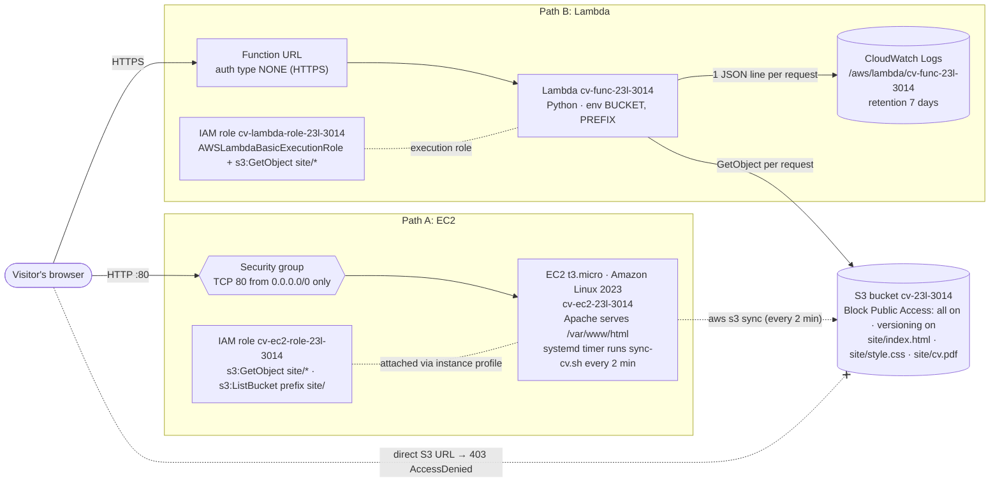

# Host Your CV on AWS: 23L-3014 (Isbah Arif)

My CV lives in a private S3 bucket. Two things read it and show it to the world. An EC2 server copies the files every 2 minutes and serves them with Apache. A Lambda function fetches the file from S3 each time someone visits. Nobody can open the bucket directly.

| | Address |
| --- | --- |
| EC2 site | http://3.83.236.254 |
| Lambda site | https://c7h7qnmhdiebbhfnnnqb6lhbse0vcoae.lambda-url.us-east-1.on.aws/ |
| S3 bucket | `cv-23l-3014` |

## Diagram



**EC2 path:** the browser hits the server's public IP on port 80, the security group lets it in, and Apache sends back its local copy of the CV. That copy comes from S3 through `sync-cv.sh`, which runs every 2 minutes using the instance role and puts `EC2` plus the instance ID in the footer.

**Lambda path:** the browser hits the function URL over HTTPS, and the function looks at the path (`/`, `/style.css`, `/cv.pdf`) to decide which file to fetch from S3 with its role. It sends that file back with the right content type, puts `Lambda` plus the function name in the footer of the page, and base64-encodes the PDF since it's binary.

## What's in the repo

```
README.md                  this file
collect-evidence.sh        evidence script
evidence.txt               output from my run of the script
site/                      index.html, style.css, cv.pdf (same files as in s3://cv-23l-3014/site/)
ec2/user-data.sh           installs Apache, sets up the sync script and a systemd timer, runs the sync once
ec2/sync-cv.sh             copies site/ from S3 into the web root, fixes the footer, writes to /var/log/cv-sync.log
lambda/lambda_function.py  the Lambda code
iam/                       trust and permission policies for both roles
```

## Access denied from the instance

I ran these on the instance through EC2 Instance Connect. The role can read the files but can't delete or overwrite them. I opened SSH only to the Instance Connect range (`18.206.107.24/29`) for this test and removed the rule right after, so the security group only allows port 80 now.

```
[ec2-user@ip-172-31-30-129 ~]$ aws s3 rm s3://cv-23l-3014/site/index.html
delete failed: s3://cv-23l-3014/site/index.html An error occurred (AccessDenied) when calling the DeleteObject operation: User: arn:aws:sts::613538400230:assumed-role/cv-ec2-role-23l-3014/i-05e433c1940e48385 is not authorized to perform: s3:DeleteObject on resource: "arn:aws:s3:::cv-23l-3014/site/index.html" because no identity-based policy allows the s3:DeleteObject action
[ec2-user@ip-172-31-30-129 ~]$ echo test > x.txt
[ec2-user@ip-172-31-30-129 ~]$ aws s3 cp x.txt s3://cv-23l-3014/site/index.html
upload failed: ./x.txt to s3://cv-23l-3014/site/index.html An error occurred (AccessDenied) when calling the PutObject operation: User: arn:aws:sts::613538400230:assumed-role/cv-ec2-role-23l-3014/i-05e433c1940e48385 is not authorized to perform: s3:PutObject on resource: "arn:aws:s3:::cv-23l-3014/site/index.html" because no identity-based policy allows the s3:PutObject action
```

## Last 10 lines of /var/log/cv-sync.log

The `cv-sync.timer` systemd timer runs the sync every 2 minutes.

```
[ec2-user@ip-172-31-30-129 ~]$ sudo tail -n 10 /var/log/cv-sync.log
2026-10-22 16:32:37 UTC sync OK instance=i-05e433c1940e48385
2026-10-22 16:34:38 UTC sync OK instance=i-05e433c1940e48385
2026-10-22 16:36:38 UTC sync OK instance=i-05e433c1940e48385
2026-10-22 16:38:39 UTC sync OK instance=i-05e433c1940e48385
2026-10-22 16:40:39 UTC sync OK instance=i-05e433c1940e48385
2026-10-22 16:42:39 UTC sync OK instance=i-05e433c1940e48385
2026-10-22 16:44:39 UTC sync OK instance=i-05e433c1940e48385
2026-10-22 16:46:39 UTC sync OK instance=i-05e433c1940e48385
2026-10-22 16:48:40 UTC sync OK instance=i-05e433c1940e48385
2026-10-22 16:50:40 UTC sync OK instance=i-05e433c1940e48385
```

## Written answers

**1. Why do the instance and the function use roles instead of access keys? What could go wrong if the keys were in the user data?**
A role works like a temporary visitor badge: AWS hands out the credentials and renews them by itself, and they only allow what's needed (reading `site/`). An access key is more like a permanent house key, and if it leaks it keeps working until someone notices and turns it off. User data isn't secret, since anyone who can view the instance's settings or anything running on the instance can read it. Mine is also in a public GitHub repo, so bots scanning GitHub would find a key in it within minutes. Someone could then use my account to delete things or run up a big bill.

**2. Someone pastes the S3 address of index.html into a browser. What do they see, and which setting causes that?**
They get a 403 error page in XML that says `AccessDenied` instead of the CV. That's because Block Public Access is on (all four settings) and there's no bucket policy or ACL that lets the public in. S3 files are private by default, so only my two roles can read them.

**3. Explain the permission on the function URL that lets anyone call it. Why is that acceptable for the function but not for the bucket?**
When I picked auth type NONE, AWS added a rule to the function's resource-based policy saying anyone (`*`) can call it with `lambda:InvokeFunctionUrl`, but only through the function URL. It doesn't let them edit the function, see its settings or use its role. That's okay because my code decides exactly what comes back: the three CV files or a 404, and every request gets logged. A public bucket would give away whatever is in it with no control or logging, and one policy mistake could expose or let someone change everything.

**4. Compare the two paths. What do you pay for when nobody visits the site? What happens if the traffic grows a hundred times?**
EC2 costs money every hour even with zero visitors, because the instance, its disk and its public IPv4 address are always running. Lambda costs nothing when idle since you pay per request, so only the small S3 storage and logs are left. If traffic grew 100 times, the single t3.micro could get overloaded, and I'd need a bigger instance or several behind a load balancer. Lambda would just run more copies automatically, and the cost would grow with the number of requests, including one S3 read per request. On EC2 the S3 cost stays the same no matter how many people visit, because it serves its local copy.

**5. You delete the EC2 instance. What do you lose and what do you still have?**
I lose the server and its disk, which means the Apache setup, the local copy of the site and the sync log. I also lose the public IP, because a new instance gets a different one. I still have the bucket with all the files and their versions, both roles, the security group, and the Lambda site, which keeps working. Since `user-data.sh` is in the repo, I can launch a new instance with it and it rebuilds the site by itself in a few minutes.

## Running the evidence script

I ran it in AWS CloudShell, which is already logged in, so no access keys are needed:

```bash
chmod +x collect-evidence.sh
./collect-evidence.sh cv-23l-3014 3.83.236.254 https://c7h7qnmhdiebbhfnnnqb6lhbse0vcoae.lambda-url.us-east-1.on.aws/
```

It writes all 11 sections to `evidence.txt` and prints `DONE`. With the wrong number of arguments it prints a usage line and exits with 1.

## Cost and hygiene

- I set up a zero-spend budget before creating anything.
- One t3.micro instance, with no Elastic IP, no NAT gateway and no load balancer.
- The bucket, instance, function and both roles are tagged `Owner=23l-3014` and `Course=cloud`.
- There are no access keys anywhere. The instance and the function use roles, and I ran the evidence script in CloudShell.

## Sources and help

- AWS documentation on S3 Block Public Access, IAM roles for EC2 and the `s3:prefix` condition, IMDSv2, Lambda function URLs, CloudWatch Logs retention, and the EC2 Instance Connect IP ranges.